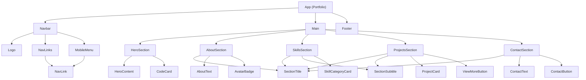

# Sesión-03

Se presenta el árbol de componetes del Portafolio personal el cuál se puede encontrar en este mismo perfil, en el repositorio llamado `Portfolio`. Tambien se presentan las trazas de los algoritmos `Piramide.psc` y `CajeroParqueadero.psc`

## Árbol de componentes

Árbol de componetes del Portafolio personal



## Trazas

### Traza del algoritmo Piramide (PSeInt)

#### Código Piramide

```PSeInt
Algoritmo Piramide
    Definir fila, i, j Como Entero

    Escribir "Ingrese la altura de la piramide:"
    Leer  i

    Para fila <- 1 Hasta i Hacer
        Para j<-1 Hasta i - fila Con Paso 1 Hacer
            Escribir Sin Saltar " "
        FinPara
        Para j<-1 Hasta 2 * fila - 1 Con Paso 1 Hacer
            Escribir Sin Saltar "*"
        FinPara
        Escribir ""
    FinPara
FinAlgoritmo
```

#### Entradas de ejemplo Piramide

Altura: `4` (es decir, `i = 4`).

#### Tabla de traza Piramide

| Momento | i | fila | ¿`fila <= i`? | Espacios (`i - fila`) | Asteriscos (`2 * fila - 1`) | Línea impresa |
| --- | --- | --- | --- | --- | --- | --- |
| Lectura | 4 | - | - | - | - | Ingrese la altura de la piramide: |
| Vuelta 1 | 4 | 1 | V | 3 | 1 | `···*` |
| Vuelta 2 | 4 | 2 | V | 2 | 3 | `··***` |
| Vuelta 3 | 4 | 3 | V | 1 | 5 | `·*****` |
| Vuelta 4 | 4 | 4 | V | 0 | 7 | `*******` |
| Fin del ciclo | 4 | 5 | **F** | - | - | (sale del ciclo) |

#### Salida final Piramide

```Text
   *
  ***
 *****
*******
```

---

### Traza del algoritmo CajeroParqueadero (PSeInt)

#### Código Cajero

```PSeInt
Algoritmo CajeroParqueadero
    Definir precio, total Como Real 
    Definir carros Como Entero

    total <- 0
    carros <- 0

    Escribir "Valor cobrado (0 para cerrar caja): "
    Leer precio

    Mientras precio <> 0 Hacer
        total <- total + precio
        carros <- carros + 1
        Escribir "Valor cobrado (0 para cerrar caja): "
        Leer precio
    FinMientras

    Escribir "Carros atendidos: ", carros
    Escribir "total recaudado: $", total

FinAlgoritmo
```

#### Entradas de ejemplo Cajero

`4000`, `8000`, `2000` y `0` (el `0` es el que cierra la caja).

#### Tabla de traza Cajero

| Momento | precio | ¿`precio <> 0`? | total | carros | Salida en pantalla |
| --- | --- | --- | --- | --- | --- |
| Inicialización | - | - | 0 | 0 | |
| Primera lectura | 4000 | V | 0 | 0 | Valor cobrado (0 para cerrar caja): |
| Vuelta 1 | 8000 | V | 4000 | 1 | Valor cobrado (0 para cerrar caja): |
| Vuelta 2 | 2000 | V | 12000 | 2 | Valor cobrado (0 para cerrar caja): |
| Vuelta 3 | 0 | **F** | 14000 | 3 | Valor cobrado (0 para cerrar caja): |
| Fin del programa | 0 | - | 14000 | 3 | Carros atendidos: 3 / total recaudado: $14000 |

#### Salida final Cajero

```Text
Carros atendidos: 3
total recaudado: $14000
```
